  
  
  

## `$ whoami`

## `$ ls ~/stack`

<table>
  <tr>
    <td align="center" width="25%"><b>Backend</b></td>
    <td></td>
  </tr>
  <tr>
    <td align="center"><b>Frontend & apps</b></td>
    <td></td>
  </tr>
  <tr>
    <td align="center"><b>Gamedev & 3D</b></td>
    <td></td>
  </tr>
  <tr>
    <td align="center"><b>Tooling</b></td>
    <td></td>
  </tr>
  <tr>
    <td align="center"><b>AI</b></td>
    <td>
      
      
      
      
    </td>
  </tr>
</table>

## `$ open ./featured`

## `$ git log --graph`

  <picture>
    <source media="(prefers-color-scheme: dark)" srcset="https://raw.githubusercontent.com/alxshmrv/alxshmrv/output/snake-dark.svg"/>
    <source media="(prefers-color-scheme: light)" srcset="https://raw.githubusercontent.com/alxshmrv/alxshmrv/output/snake-light.svg"/>
    
  </picture>

  

